# PicoCalc Studio

A C development environment that runs **on the [ClockworkPi PicoCalc](https://www.clockworkpi.com/picocalc)**.
You write, build, run and package programs on the device itself, with no PC involved: an editor
with completion and go-to-declaration, a C compiler that targets the board's RISC-V CPU, a runner
that catches crashes, and an exporter that turns a program into a standalone firmware for
[PicoMultiLoader](#installing).

<p align="center">
  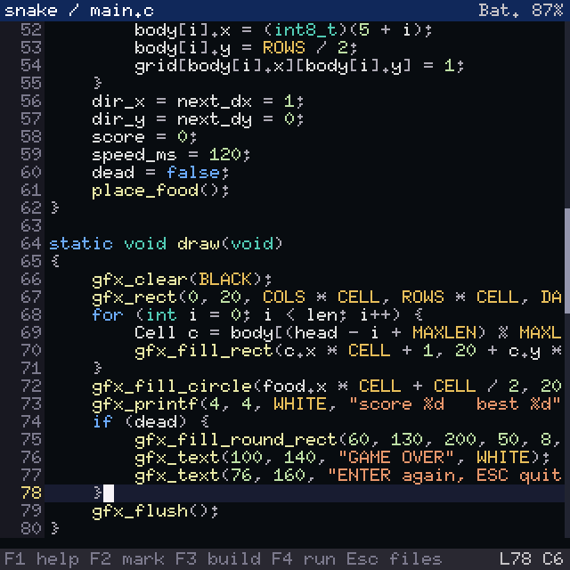
  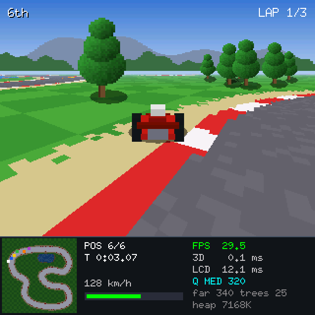
</p>

- **Editor**: syntax colours, Ctrl-Space completion from the SDK headers and your project, F9 go to declaration (into the headers and the SDK sources too), find/replace, undo/redo, selection and clipboard, multi-file projects.
- **Compiler**: a fork of [chibicc](https://github.com/rui314/chibicc) with an RV32 code generator and linker of its own (C11, `float` on the FPU, `double` in software). Builds take from a fraction of a second to a few seconds. Errors land on the line, in the status bar.
- **Runner**: F4 builds and runs. Break stops the program. Files, memory and sound it leaves behind are cleaned up. If it crashes, the IDE reopens at the line where it crashed.
- **Export**: F5 writes `<project>.bin` (ESP32-P4) or `<project>.uf2` (Pico 2 W), a copy of the firmware that boots straight into your program. PicoMultiLoader flashes it like any other app.
- **SDK**: `picocalc.h`, which covers a 320×320 framebuffer with drawing primitives and fonts, the keyboard, sound (tones and streamed samples), time, battery and backlights. You also get a C library (stdio, files and directories on the SD card, `malloc`, `math.h`, …).
- **19 examples**, from `hello` to a mode-7 kart racer, a voxel flight game and a polygon space shooter.

## Boards

| Board | CPU | Memory | Export | Status |
|---|---|---|---|---|
| PicoCalc + **ESP32-P4** module | RISC-V with FPU | PSRAM | `.bin` | main target |
| PicoCalc + **Raspberry Pi Pico 2 W** (RP2350) | Hazard3 RISC-V, 150 MHz, soft-float | 520 KB SRAM, no PSRAM | `.uf2` | runs. The largest examples don't fit in RAM. Needs a PicoMultiLoader whose boot stub can start a RISC-V image. |

## Screenshots

### The IDE

| | |
|---|---|
| 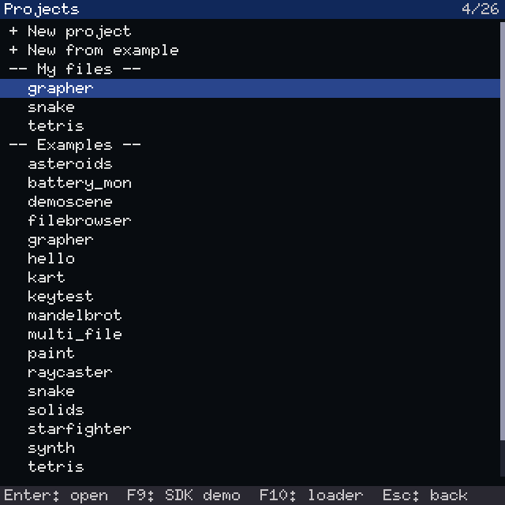 |  |
| **Projects**: your own (My files) and the read-only examples. "+ New from example" copies one to change. | **Editor**: line numbers, syntax colours, the file and battery in the title bar. |
| 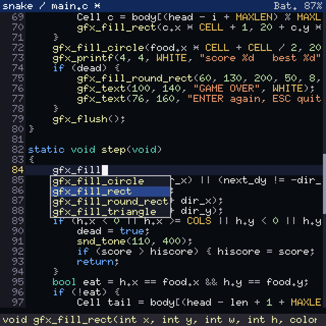 | 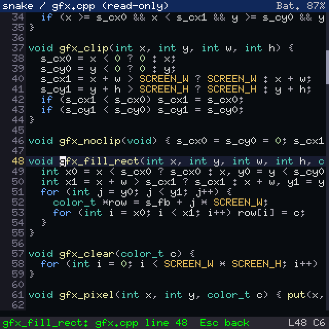 |
| **Ctrl-Space** completes from C, the headers and the project. The status bar shows the chosen name's declaration. | **F9** on `gfx_fill_rect` opens the SDK's own source, read-only. Esc comes back. |
| 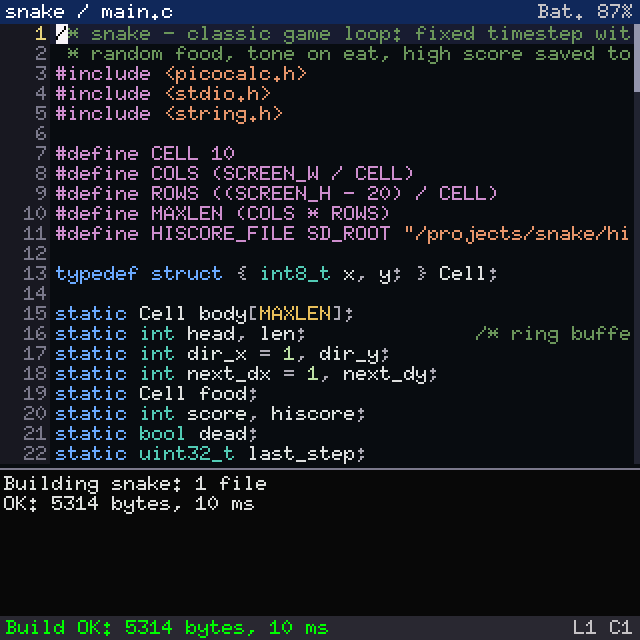 | 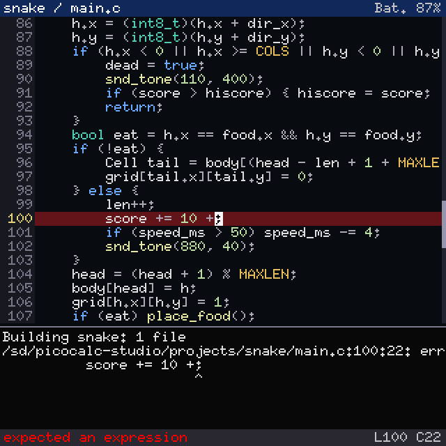 |
| **F3** builds. The output panel shows what happened. | A build error marks the line and points at the column. |
| 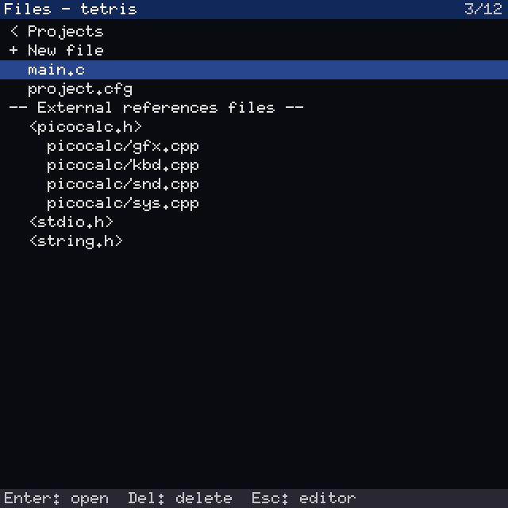 | 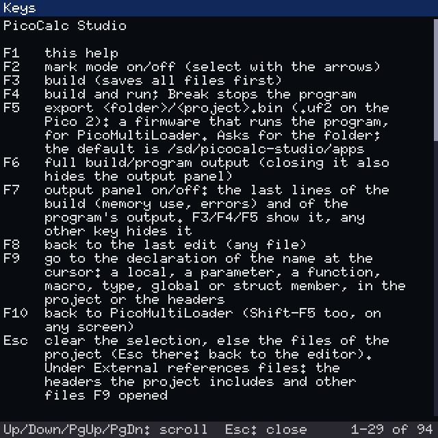 |
| **Esc**: the project's files, and the headers and SDK sources it uses. | **F1**: the keys, and every header the compiler offers. |

### Example programs

| | |
|---|---|
|  | 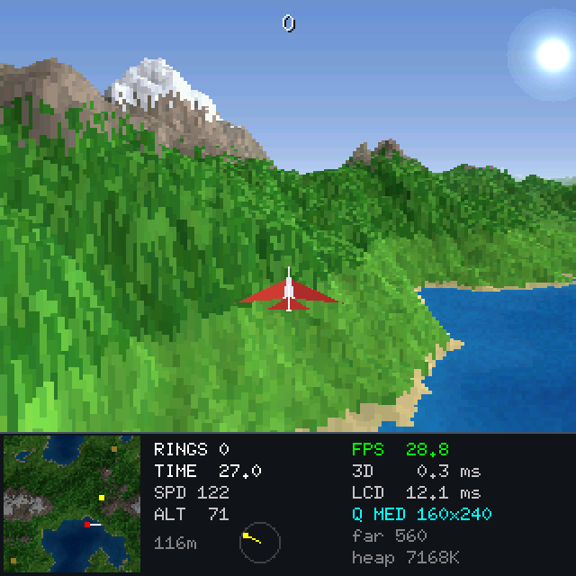 |
| **kart**: mode-7 racing against five computer drivers | **voxel**: flying over height-field terrain, Comanche style |
| 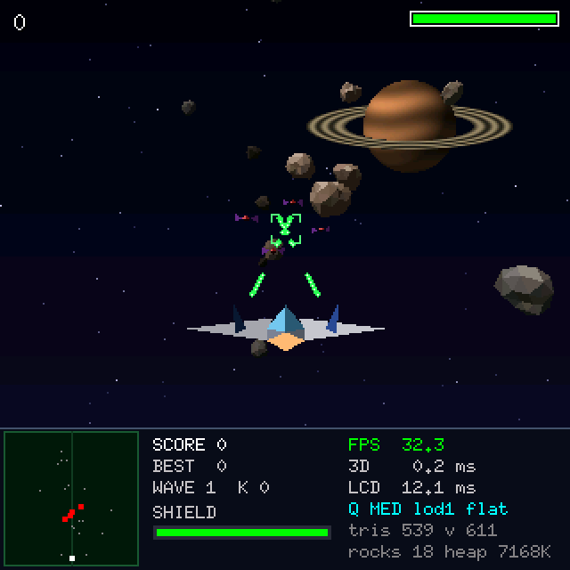 | 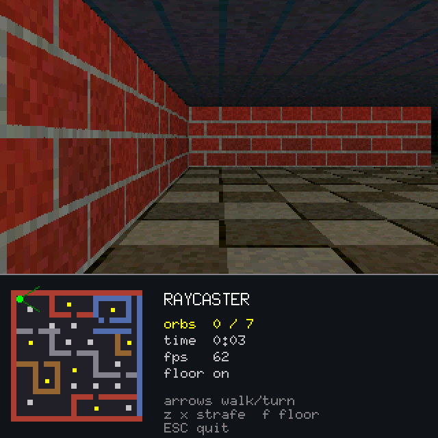 |
| **starfighter**: a flat-shaded polygon shooter | **raycaster**: a textured maze, Wolfenstein 3D style |
| 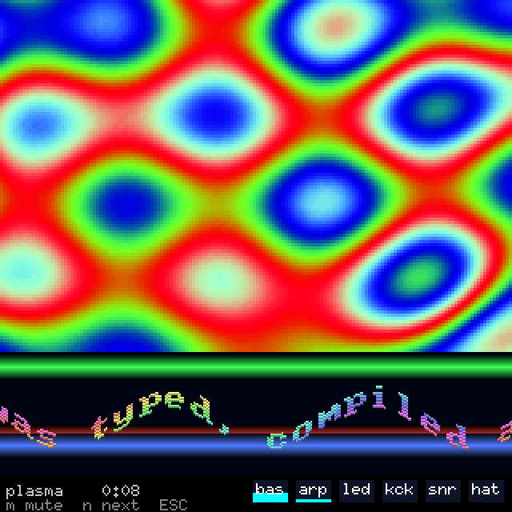 | 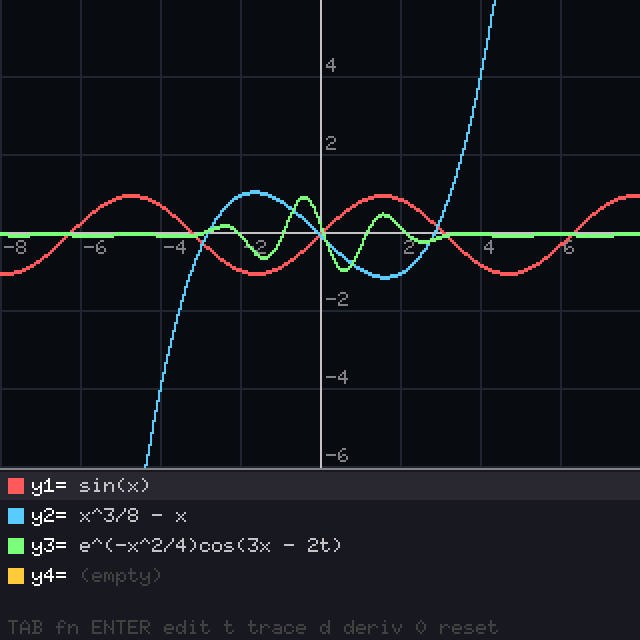 |
| **demoscene**: plasma, copper bars and a sine scroller, synced to a chiptune made on the fly | **grapher**: plots up to four functions with symbolic derivatives |
| 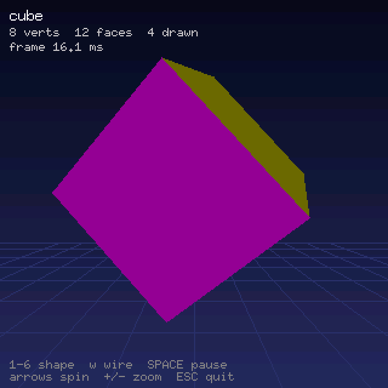 | 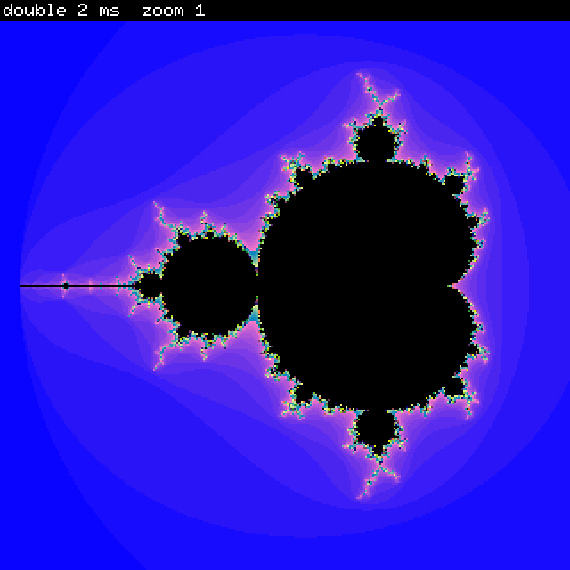 |
| **solids**: rotating 3D meshes with lighting | **mandelbrot**: `float` vs `double` speed |
| 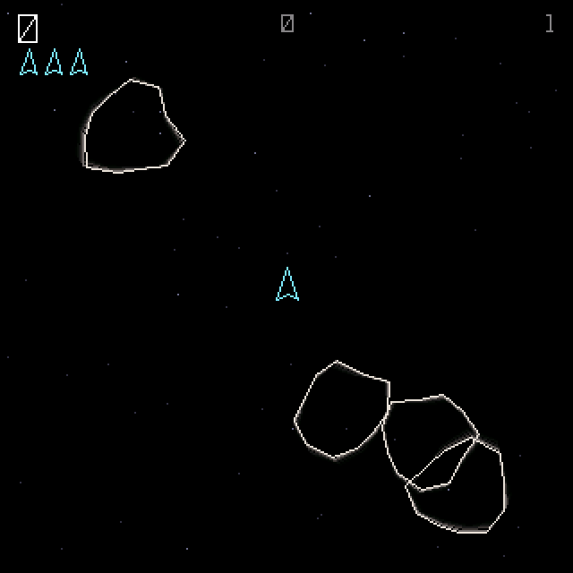 | 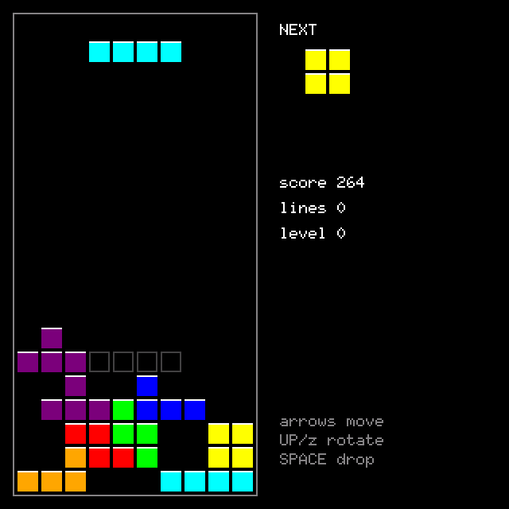 |
| **asteroids**: vector graphics with phosphor trails | **tetris** |

> These screenshots come from [`tools/host/shots`](#screenshots-1), which builds the real IDE and SDK for
> the PC. The pixels match what the device draws. Timings that programs print (build ms, "3D ms")
> are the PC's; frame rates are close to the device's, because the harness's LCD takes as long as
> the real one.

## Installing

PicoCalc Studio is an app for **PicoMultiLoader**, the PicoCalc's SD-card boot menu. Don't flash
it with `arduino-cli upload` or esptool: on the P4 that would also overwrite the bootloader and
partition table, and the loader with them.

1. Build the firmware (see [Building](#building)), or take a release build:
   `picocalc_studio.bin` (ESP32-P4) or `picocalc_studio.uf2` (Pico 2 W).
2. Copy it to the SD card where PicoMultiLoader looks for apps.
3. Copy this repo's [`sdcard/picocalc-studio`](sdcard/picocalc-studio) folder to the root of the
   SD card. It has the C headers, the SDK sources (for F9), the examples and the compiler tests.
4. Pick PicoCalc Studio in the loader menu.

SD card layout:

```
/picocalc-studio/
  include/      C and SDK headers (picocalc.h)
  lib/picocalc/ SDK sources, shown read-only by F9
  examples/     the examples (read-only in the IDE)
  projects/     your projects: one folder each, every .c file in it is built
  apps/         default folder for F5 exports
  tests/        compiler self-test (@test)
  ide.cfg       the last project and file
```

## Writing a program

A program is a folder in `projects/` with one or more `.c` files. It has `setup()` and `loop()`
(or a plain `main()`):

```c
#include <picocalc.h>
#include <stdio.h>

void setup(void)
{
    gfx_clear(NAVY);
    gfx_font(FONT_7X13);
    gfx_text(20, 20, "Hello, PicoCalc!", WHITE);
    gfx_flush();
}

void loop(void)
{
    int k = kbd_get();
    if (k == KEY_ESC) sys_exit();
    if (k != KEY_NONE) printf("key %d\n", k);   /* printf shows in the output panel (F7) */
    sys_delay(16);
}
```

The SDK at a glance ([`picocalc.h`](sdcard/picocalc-studio/include/picocalc.h) has the details,
and F1 shows it on the device):

| | |
|---|---|
| **gfx_** | `clear` `pixel` `get_pixel` `line` `hline` `vline` `rect` `fill_rect` `round_rect` `fill_round_rect` `circle` `fill_circle` `triangle` `fill_triangle` `blit` `scroll` `clip` `noclip` `font` `text` `text_bg` `printf` `text_width` `flush` `flush_rect`, and `gfx_framebuffer()` for direct pixel access (RGB565, 320×320) |
| **kbd_** | `get` `wait` `event` (raw press/release) `down` (is it held) `mods` `flush` `backlight` |
| **snd_** | `tone` `play` (stream 16-bit samples) `busy` `stop` `volume` |
| **sys_** | `millis` `micros` `delay` `yield` `random` `seed` `battery` `backlight` `free_heap` `log` `exit` `exit_to_loader` |

To use code from another project, `#include "../other/x.h"`. Its `x.c` is then built with your
project.

## IDE keys

| Key | | Key | |
|---|---|---|---|
| F1 | help, headers | Ctrl-Space | completion |
| F2 | mark mode (select) | Ctrl-S | save all |
| F3 | build | Ctrl-G | go to line |
| F4 | build and run (Break stops) | Ctrl-F / Ctrl-N | find / next |
| F5 | export `.bin` / `.uf2` | Ctrl-R | replace |
| F6 | full output | Ctrl-Z / Ctrl-Y | undo / redo |
| F7 | output panel on/off | Ctrl-K / Ctrl-D | delete / duplicate line |
| F8 | back to the last edit | Ctrl-C / X / V | copy / cut / paste |
| F9 | go to declaration | Alt + arrows | select |
| F10 | back to PicoMultiLoader | Tab / Alt-Tab | indent / unindent |
| Esc | the project's files | Ctrl-A | select all |

## Building

Needs [arduino-cli](https://arduino.github.io/arduino-cli/) with the cores below. Neither script
uploads anything.

```powershell
tools\build.ps1           # ESP32-P4 (arduino-esp32)       -> build\picocalc_studio_p4\picocalc_studio.bin
tools\build_rp2350.ps1    # Pico 2 W (arduino-pico, RISC-V) -> build\picocalc_studio_rp2350\picocalc_studio.uf2
```

`tools\build.ps1 -Project <name>` compiles a `tests/projects` program into the firmware with gcc.
That gives a reference build to compare against the on-device compiler.

## Testing on the PC

The compiler is plain C. It builds and runs on the PC, and its RV32 output runs in a small emulator:

```sh
python tools/host/build_host.py      # build/host: pcc.exe (the compiler), rvsim.exe (RV32 emulator), pcxrun.elf
python tools/host/run_tests.py       # validate the tests themselves (host gcc, riscv32 gcc, rvsim)
python tools/host/run_tests.py pcc --pcc "<abs path>/build/host/pcc.exe {src} -o {out}" --exec rvsim
python tools/host/bench.py           # code speed (instruction counts) against tests/bench/baseline.json
python tools/host/mem.py             # compiler memory peak per project (matters on the Pico 2 W)
```

On the device, `@test` sent over the USB serial port runs the same test suite. See
[tests/README.md](tests/README.md).

### Screenshots

```sh
python tools/host/shots/shots.py              # every screenshot in docs/screenshots/
python tools/host/shots/shots.py ide-error    # just one
```

`tools/host/shots` builds the IDE (with the real compiler) and each example natively with MinGW
gcc. The PC stand-in for the HAL draws into memory and replays a key script. Each shot is a short
script in `shots.py` (`key`, `ctrl`, `type`, `hold`, `wait`, `shot`). Running a program inside the
IDE isn't supported there, so each example is built with gcc as its own program instead. It needs
gcc/g++ and Pillow.

## Repository layout

```
firmware/picocalc_studio/     the firmware (Arduino sketch)
  src/cc/                     the C compiler: chibicc fork, RV32 codegen, assembler, linker
  src/ide/                    editor, documents, completion, the IDE
  src/ui/                     menus, lists, text views
  src/rt/                     module loader, runner, exports table, self-test
  src/sdk/                    picocalc.h implementation (gfx, kbd, snd, sys), fonts
  src/export/                 F5: firmware image with the program in its slot
  src/hal/picocalc_p4/        ESP32-P4: display, keyboard, audio, system
  src/hal/picocalc_rp2350/    Pico 2 W: the same, plus POSIX on SD, module loader, export
firmware/spikes/              feasibility spikes (docs/PHASE0.md)
sdcard/picocalc-studio/       what goes on the SD card
tests/                        compiler tests: unit, errors, projects, benchmarks
tools/                        build scripts, export table generator
tools/host/                   PC tools: pcc, rvsim, test runner, benchmarks, screenshots
docs/                         design notes, screenshots
```

## Third-party code

The compiler is based on chibicc (MIT). The fonts are public domain, and the firmware is built
on the Arduino cores for ESP32 and RP2350. See [THIRD_PARTY_NOTICES.md](THIRD_PARTY_NOTICES.md).
